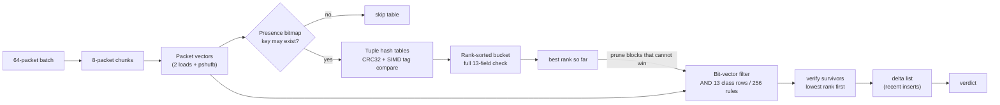

<div align="center">

# ⚡ Packet Rush: an exact packet classifier at line rate

**Synergy '26 Low-Level Hackathon · Track: Computer Networks · Question ID: `CN10`**
**Team Lohith Pasumarthi 25**


-~1000×%20faster%20than%20linear-blue)


*Classifies 14 to 60 million packets per second on one core against up to 40,000 rules, and returns exactly the same verdict as a linear scan for every packet.*

[Quick start](#-quick-start-60-seconds) · [Results](#-results) · [How it works](#-how-it-works) · [Proof of correctness](#-why-the-answers-are-exact) · [Demo](#-demo) · [Repository map](#-repository-map)

</div>

---

## 🧩 The problem in one paragraph

A firewall or router compares each packet against thousands of rules, where each rule constrains up to 13 fields: IP prefixes, port ranges, protocol, TCP flags, VLAN, region, length, TTL and more. The answer is the action of the **highest-priority rule that matches**. The organiser's reference does this with a linear scan, which is correct but slow: on the 40,000-rule scenario it manages **0.015 Mpps**. Our entry must give **exactly the same answers**, much faster. It is scored on throughput, p99 batch latency, peak memory (hard limit 32 MiB) and update latency, and it must support live rule inserts and deletes.

<details open>
<summary><b>A worked example (read this if you are new to packet classification)</b></summary>

A **rule** says which packets it applies to and what to do with them. Any field it leaves out matches everything:

| rule id | priority | matches | action |
|---|---|---|---|
| 1001 | 1000 | destination 192.168.7.9, port 443, TCP | ACCEPT |
| 1002 | 999 | destination 192.168.7.0/24 (any port, any protocol) | DROP |

A **packet** arrives: TCP, `10.1.2.3:51000 → 192.168.7.9:443`.

- Only rule 1001 exists: it matches, so the verdict is **ACCEPT**.
- Rule 1002 is inserted. Both rules match now. The **lower priority number wins** (999 beats 1000), so the verdict is
  **DROP**. If two matching rules share a priority, the lower rule id wins.
- Rule 1002 is deleted: the verdict is **ACCEPT** again. This is exactly what [the demo](#-demo) runs live.

Now scale that up: up to **40,000 rules**, **13 fields** per rule (some are ranges, some are prefixes, some are
"anything"), tens of millions of packets, and rules added and removed while traffic flows. Checking every rule for
every packet (the organiser's reference) is always right but far too slow. The challenge is to be just as right while
skipping almost all of that work.

| term | meaning |
|---|---|
| **Mpps** | million packets per second. Full marks need 25 Mpps on one core. |
| **p99 batch latency** | the time to classify a batch of 64 packets, at the 99th percentile. Full marks need 2.5 µs or less. |
| **wildcard** | a field the rule does not care about ("any port"). |
| **prefix** | an IP range written as address/length, e.g. `192.168.7.0/24` = the 256 addresses starting with 192.168.7. |
| **rank** | how rules are ordered: priority first, then rule id. The best-ranked matching rule decides the verdict. |

**How the score works.** Each of five scenarios scores out of 100: 40 for throughput, 25 for p99 batch latency, 20 for
staying under 32 MiB of memory (above it the run scores zero), and 15 for update latency (full marks at 5 µs or less).
The five scores are weighted 15/20/25/20/20 %. **A single wrong verdict scores zero.**
</details>

## 🚀 Quick start (60 seconds)

Linux, g++ 11 or newer, Python 3 (standard library only).

```bash
git clone https://github.com/Lohith248/synergy26-lowlevel-cn10-packet-rush.git && cd synergy26-lowlevel-cn10-packet-rush
bash scripts/run_scenarios.sh          # generate the 5 official scenario shapes, build, run, compare, score
bash demo/run_demo.sh                  # live rule insert/delete demo, checked against the baseline
make test                              # the organiser's own test suite and sample benchmark
```

`run_scenarios.sh` builds with the judge's exact flags (`g++ -O3 -std=c++20 -march=native -Wall -Wextra`), runs our classifier **and** the organiser's linear baseline on every scenario, and stops with an error if any verdict differs. It then scores each scenario with the organiser's `evaluator/scoring.py`. Use `CPU=4 bash scripts/run_scenarios.sh` to pin to an idle core, or pass another seed: `bash scripts/run_scenarios.sh 7`.

<details>
<summary><b>No compiler? Use the prebuilt binaries</b></summary>

`bin/` holds statically linked Linux x86-64 builds of the organiser's benchmark with our classifier (stripped, g++ 13.4):

| file | CPUs | sha256 (first 16) |
|---|---|---|
| `bin/benchmark_x86-64-v3` | AVX2 machines (Intel Haswell+, AMD Zen+) | `d289812a1acc4b0d` |
| `bin/benchmark_x86-64-v2` | any x86-64 from roughly 2009 on | `7318e41ad968949d` |
| `bin/flip_demo_x86-64-v3` | live update demo | `9673346af9e95ee9` |

```bash
BIN=bin/benchmark_x86-64-v3 bash scripts/run_scenarios.sh
bin/flip_demo_x86-64-v3 --rules data/sample_rules.bin
```
The judge builds from source with `-march=native`; these binaries are only for quick testing.
</details>

<details>
<summary><b>Use only the two submitted files with your own copy of the starter pack</b></summary>

The entry is exactly `starter/classifier.h` and `starter/classifier.cpp` (the rules allow changes only there). Copy them into the organiser's `starter/` folder and run `make`.

| file | sha256 |
|---|---|
| `starter/classifier.cpp` | `b25958881c9abb9d07aaf2edb4b4edbec158e723870eb95344259c9634f3c8bb` |
| `starter/classifier.h` | `cbbff101328a5e9cb49bf16db8ab51c896f073def2479bc65c8cff465a6cb68b` |
</details>

## 📊 Results

**Every verdict on every scenario is identical to the organiser's baseline.** Throughput on one core of an Intel i9-12900K, judge flags, g++ 13.4:

| scenario (weight) | rules / packets | linear baseline | **ours** | speed-up |
|---|---|---:|---:|---:|
| s01 correctness_small (15%) | 1,000 / 5,000 | 1.5 Mpps | **34.6 Mpps** | ~22× |
| s02 scalability_medium (20%) | 15,000 / 20,000 | 0.042 Mpps | **20.0 Mpps** | ~475× |
| s03 performance_large (25%) | 40,000 / 30,000 | 0.015 Mpps | **14.0 Mpps** | **~1,000×** |
| s04 adversarial_skew (20%) | 20,000 / 20,000, 65% wildcards | 27 Mpps | **60.2 Mpps** | ~2× |
| s05 dynamic_heavy (20%) | 15,000 + 10,000 updates | 0.041 Mpps | **20.2 Mpps** | ~490× |

Ours: mean of four seeds' medians, 40 alternating runs per cell. Baseline: seed 42, single run (it takes seconds per scenario).

| metric | limit for full marks | ours |
|---|---|---|
| Peak memory (RSS) | ≤ 32 MiB (hard cliff) | **24.5 MiB** on s03; 29.7 MiB even at 60,000 rules |
| Update p99 (insert/delete) | ≤ 5 µs | **≤ 0.8 µs** (s05: ~0.3 µs) |
| Weighted score, organiser formula, measured locally | 100 | **83 to 86** across seeds and builds (`run_scenarios.sh` prints ~86 to 87) |

> These are our own measurements with the organiser's harness and formula. They are not a prediction of the judges' scores, which depend on their hardware.

<details>
<summary><b>How we got here: five measured versions</b></summary>

Every step had to be exact, pass the full test gate, and beat the previous version in paired runs (alternating order, same machine). Otherwise it was reverted.

| version | idea | local weighted score |
|---|---|---:|
| R3 | Tuple-space hash tables + lane-major SIMD sweep for leftover rules | (starting point) |
| R4 | **Bit-vector filter** for leftover rules: AND 13 bitmap rows per 256 rules | 75–78 |
| R5 | Instruction diet: `pshufb` packet vectors, CRC32 hashing, SIMD tag compare, branchless first match | 80–83 |
| R6 | Pipelined 8-packet chunks (hash → probe → scan overlap in L1) | 81–84 |
| **R7** | **Presence bitmaps** skip empty probes; **hybrid port classes** cut false candidates | **83–86** |

We also tried ideas that failed and were reverted: partitioned filters, joint rows, row prefetching, branch-free block scans and planner retuning. They are recorded in the receipts.
</details>

## 🛠 How it works



1. **Planner.** On load it picks up to 16 hash-table "shapes" (for example destination /16, or region + VLAN) with a cost model, placing each rule in the first table whose key the rule fully fixes. On the 40k-rule scenario, 4 tables absorb about 94% of the rules.
2. **Tuple hash tables.** Each table maps a key to a rank-sorted bucket of 64-byte, cache-line-sized rule records. A lookup is one CRC32 hash, one cache line holding 4 tags compared with SIMD, then a scan that stops as soon as a record ranks below the best match so far.
3. **Presence bitmaps (R7).** Most probes (60–70%) find nothing. A small per-table bitmap answers "could this key exist?" so that most empty probes are never issued.
4. **Bit-vector residual filter.** The rules no table covers (1–2.5k) live in a filter. For each of 13 fields the packet's value selects one bitmap row. AND-ing the rows leaves a superset of the matching rules, which is then verified, lowest rank first. Blocks whose best possible rank cannot beat the current answer are skipped.
5. **Catch-all dominance.** Rules ranked behind an "everything matches" rule can never win, so they are not indexed. This is why s04 (65% wildcards) runs at 60 Mpps.
6. **Updates.** These are two-phase: allocate everything first (this may fail, leaving the state untouched), then commit without allocating. New leftover rules go to a small delta list. When it fills, the filter is rebuilt on the side and swapped in.

Full design and the exactness argument: **[docs/DESIGN.md](docs/DESIGN.md)**.

## ✅ Why the answers are exact

<details open>
<summary><b>The argument in four lines</b></summary>

- Every filter row is a **superset**: it includes every rule that accepts *any* value of that class. So a matching rule survives the AND.
- Every survivor, and every bucket record, gets the **full 13-field check**. False positives cost time, never correctness.
- Hash tags, presence bitmaps and the planner can only make us **skip work that provably cannot match**, or do extra work. They never change an answer.
- Ties are broken by `rank = priority << 32 | rule_id`, exactly as in the reference. All 64-bit ranks are legal, including the maximum.
</details>

<details>
<summary><b>How we tested it (click)</b></summary>

| check | result | receipt |
|---|---|---|
| Release gate, g++ 13.4: fuzzing at 4 ISA levels, allocation-failure injection, interleaved updates, churn, ASAN/UBSAN | **PASSED** | [`receipts/release_gate.log`](receipts/release_gate.log) |
| 15 deliberately planted bugs; the gate must catch each one | **15/15 caught** | same |
| Extra mutations for R7 code (bitmaps, probe lists, port classes) | all correctness mutations caught | [`receipts/mutations_presence_bitmap.log`](receipts/mutations_presence_bitmap.log), [`mutations_bitvector.log`](receipts/mutations_bitvector.log) |
| Wide differential gate: 20 configurations, fresh seeds, sanitizers | **20/20 OK** | [`receipts/wide_gate.log`](receipts/wide_gate.log) |
| 40 extra rule-set families (1 to 60,000 rules, wildcard rate 0 to 1.0, priority ties) plus size edges | **264/264 identical** to the reference | [`receipts/robustness.log`](receipts/robustness.log) |
| `-Werror` builds for x86-64, v2, v3, native, znver3, znver4, skylake-avx512, sapphirerapids | all compile | [`receipts/acceptance_chain.log`](receipts/acceptance_chain.log) |
| README build steps, sample benchmark vs baseline, live demo (g++ 13.4) | pass | [`receipts/package_check.txt`](receipts/package_check.txt) |
| This repository from a fresh clone: `run_scenarios.sh`, `make test`, demo, prebuilt binaries | pass | [`receipts/repo_check.txt`](receipts/repo_check.txt) |
| Machine-readable acceptance verdict | `"accepted": true` | [`receipts/acceptance.json`](receipts/acceptance.json); re-run with `python3 verify/check_acceptance.py receipts` |

Run the fuzzers yourself: `bash verify/run_wide.sh starter 200` (Linux). More in [docs/BENCHMARKS.md](docs/BENCHMARKS.md).
</details>

<details>
<summary><b>Edge cases handled</b></summary>

- `packet_len < 20` (malformed) and packets shorter than the catch-all's length bound take an exact full scan.
- A duplicate `rule_id` replaces the earlier rule atomically. Invalid rules (prefix > 32, `low > high`) are rejected with no state change.
- `std::bad_alloc` during insert or replace leaves the classifier exactly as it was (tested by allocation-failure injection).
- Deleting the best catch-all rebuilds the index on the side. Lookups never see a half-built state.
</details>

## 🎬 Demo

```bash
bash demo/run_demo.sh
```
```text
[b] verdict: ACCEPT  (rule 1001: exact-match ACCEPT, priority 1000)   baseline agrees
[c] insert rule 1002 (DROP dst 192.168.7.0/24, priority 999): verdict: DROP (insert took 0.38 us)   baseline agrees
[d] delete rule 1002: verdict: ACCEPT (delete took 0.38 us)   baseline agrees
[f] 100000 packets: 0 differences (half crafted to hit rules, batches of 64; 12224 ACCEPT, 87776 other)
RESULT: all checks passed
```
One packet flips **ACCEPT → DROP → ACCEPT** as a rule is inserted and deleted live, with the baseline checked at every step. Then 100,000 packets run with zero differences.

## 🗂 Repository map

| path | what | author |
|---|---|---|
| `starter/classifier.h`, `starter/classifier.cpp` | **the entry**: the classifier | team |
| `scripts/run_scenarios.sh` | one-command build, run, compare and score | team |
| `demo/` | live update demo (`flip.cpp`) | team |
| `verify/` | differential fuzzers, allocation-failure and churn tests, mutation lists, acceptance evaluator | team |
| `docs/DESIGN.md`, `docs/BENCHMARKS.md` | architecture, exactness argument, measurements | team |
| `receipts/` | raw logs behind every number above, indexed in [`receipts/README.md`](receipts/README.md) | team |
| `bin/` | prebuilt static Linux binaries | team (built from this repo) |
| `include/`, `baseline/`, `evaluator/`, `generator/`, `tests/`, `data/`, `Makefile`, `CMakeLists.txt`, `Dockerfile`, `SPECIFICATION.md`, `docs/organiser/` | the organiser's starter pack, **unchanged** | organiser |

## ⚠️ Known limits (honest list)

- On the s03 shape (40k rules, many disjoint wildcard shapes) we reach about 14 Mpps, below the 25 Mpps full-marks line. The leftover-rule filter is the bottleneck.
- Memory reaches 29.7 MiB at 60,000 rules. That is above the official maximum of 40,000 rules, but close to the 32 MiB ceiling.
- Replacing the best catch-all rule rebuilds the index, which is correct but costs milliseconds.
- Throughput was measured on a shared lab host; expect ±5% run-to-run noise.

---

<div align="center">

**Team Lohith Pasumarthi 25** · Synergy '26 Low-Level Hackathon, 9–13 November 2026 · Computer Networks · CN10

</div>
